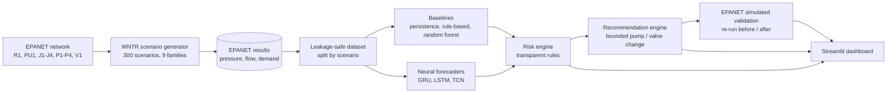

# AquaBalance

**Deep Learning–Assisted Prediction and Control Recommendation for Junction-Level Pressure Imbalance in Water Distribution Networks**

> **This is a simulation-based decision-support prototype, not autonomous real-world utility control.**
> All data comes from EPANET hydraulic simulations run through WNTR. No real utility data, no real sensors and no real equipment are used.
> Every validation in this project is an **EPANET simulated validation**: *This validates the recommendation in the simulated EPANET network. It is not field validation in an actual water utility.*

AquaBalance is an undergraduate project. It forecasts the pressure at three consumer junctions 15 minutes ahead, turns the
forecast into a transparent risk label, proposes a small bounded pump or valve change, and checks that change by re-running
the scenario in EPANET. Sensors measure pressure and flow; they do not equalize pressure. The goal is **safe pressure ranges**
(and a limited pressure spread), not equal pressure everywhere.

**EPANET is the mandatory primary hydraulic simulator.** There is no fallback simulator.

## Contents

1. [Architecture](#architecture)
2. [Methodology](#methodology)
3. [Results at a glance](#results-at-a-glance)
4. [Installation](#installation)
5. [Commands for every phase](#commands-for-every-phase)
6. [Phase details](#phase-details)
7. [Dashboard](#run-phase-7-dashboard-streamlit)
8. [Repository layout](#repository-layout)
9. [Limitations](#limitations)
10. [Ethics and safety notes](#ethics-and-safety-notes)
11. [Future scope](#future-scope)
12. [Troubleshooting](#troubleshooting)

## Architecture



Plain-text version (same flow):

```
EPANET network -> WNTR scenarios -> EPANET results -> dataset (split by scenario)
   -> baselines + GRU/LSTM/TCN forecasters -> risk engine -> recommendation engine
   -> EPANET simulated validation (re-run) -> Streamlit dashboard
```

The network (4 junctions, 4 pipes, 1 pump, 1 pressure-reducing valve, no tank):

```
                          valve V1 (PRV)
R1 --PU1--> JP1 --P1--> J1 ----P2----> JV1 ==V1==> J2  (residential)
 reservoir   pump       hub  |
                             +--P3--> J3  (school)
                             +--P4--> J4  (hospital / critical service)
```

JP1 and JV1 are zero-demand helper nodes that EPANET needs on each side of the pump and the valve.

**Sensors versus actuators.** *Sensors* measure: pressures, flows, demands and the reported pump speed and valve setting; the models read only these.
*Actuators* change the network: the pump (speed) and the valve (setting). In this project the recommendation engine only
*suggests* an actuator change inside the simulation; nothing is connected to real equipment.

## Methodology

1. **Scenario generation (EPANET through WNTR).** Random numbers choose only the *settings* of a scenario (source head, pump speed, valve setting,
   demand pattern, leak, blockage). EPANET computes every pressure and flow. Nine families: normal, high-demand stress, high source pressure / fast pump,
   valve misconfiguration, reduced supply, small leak, burst leak, pump degradation, partial blockage. Each scenario is 24 h at 15-minute steps and can be replayed exactly from `data/synthetic/scenario_specs.jsonl`.
2. **Labels.** Lab-prototype thresholds in `config/config.yaml`: pressure 20–60 m, J4 (critical) minimum 30 m, imbalance when the spread of J2–J4 exceeds 20 m.
   They are teaching values, not utility standards. *Pressure imbalance is not "pressures are unequal": junctions naturally differ with elevation and demand. It means the spread exceeds the limit.*
3. **Dataset without leakage.** Whole scenarios are split 70/15/15 (stratified by family); windows never cross a scenario; scalers are fitted on training scenarios only; scenario type, leak flag and leak size are never inputs.
   Task: last 12 steps (3 h) of sensor/control features → pressure at J2, J3, J4 in 15 minutes.
4. **Forecasters, compared fairly.** Persistence, random forest, **GRU**, **LSTM** and a small **TCN** (causal dilated Conv1D with residual blocks). The three neural networks have similar parameter counts, the same inputs, splits, loss, optimiser, seed policy and metrics.
   No model is assumed best; see the results.
5. **Risk engine (rules, no neural network).** Low / high pressure, imbalance, leak-like (pressure drop *and* inflow-minus-demand mismatch), burst-like; J4 is treated most strictly.
6. **Recommendation engine (bounded).** Pump about ±10 %, valve about ±15 %, smallest effective step; leak-like and burst-like patterns give an inspection recommendation only.
7. **EPANET simulated validation.** Each recommendation is re-run in EPANET before and after every bounded candidate; a candidate is rejected if any node gets worse or J4 is sacrificed. If none is safe the answer is `No safe action found; operator inspection recommended.`
8. **Dashboard.** A one-page Streamlit app that shows all of the above and runs the validation on demand.

## Results at a glance

Test split (45 scenarios never seen in training), next-15-minute pressure at J2/J3/J4. Full tables: `outputs/reports/final_results_summary.md`.

| Model | Parameters | Test MAE (m) | Test RMSE (m) | Risk macro F1 |
|---|---|---|---|---|
| Persistence | none | 0.1310 | 0.6286 | 0.9923 |
| Random forest | n/a | **0.0645** | 0.4389 | 0.9983 |
| GRU | 26,691 | 0.1028 | 0.5646 | 0.9962 |
| LSTM | 26,723 | 0.1052 | 0.5840 | 0.9944 |
| TCN | 26,009 | 0.0875 | 0.5005 | 0.9974 |

- **No neural network beat the random forest** on this small, smooth, synthetic task. The TCN was the best of the three networks and this held across extra seeds; the GRU and LSTM are close together.
- **EPANET simulated validation** of 23 recommendations: 11 improved the simulated network (1 fully resolved the problem, 10 partly), 5 needed no action, 2 had no safe action, 5 were inspection-only.
- This is a simulation-based result. It says nothing about performance on a real utility.

## Installation

You need Python and Git. The project was developed and tested on Python 3.13 (Linux). WNTR contains a compiled part, so if `pip` has no ready-made package for your Python version it tries to build from source and can fail; **Python 3.11 or 3.12 is the safest choice** on a Mac.

```bash
git clone https://github.com/suhaantpatel/aquabalance.git
cd aquabalance
python3 -m venv .venv
source .venv/bin/activate            # Windows PowerShell: .venv\Scripts\Activate.ps1
python -m pip install --upgrade pip
python -m pip install -r requirements.txt          # core: WNTR/EPANET, pandas, scikit-learn, Streamlit, ...
python -m pip install -r requirements-deep.txt     # PyTorch for GRU/LSTM/TCN (optional, see Troubleshooting)
python -c "import wntr; print('WNTR', wntr.__version__)"
```

Always use `python -m pip` and `python -m streamlit` so the tools match the Python you activated. Run every command from the repository folder (the one that contains `config/`).

Without PyTorch you can still: build the network, generate EPANET scenarios, train and use the baselines, run the risk and recommendation engines, run EPANET validation (with the random forest or persistence forecast), and use the dashboard (the GRU/LSTM/TCN then appear only as stored demo forecasts, if `data/sample/` is present).

## Commands for every phase

Run in this order from the repository folder. Times are rough laptop-CPU figures.

| Phase | What it does | Command |
|---|---|---|
| 1 | Build the EPANET network and figure | `python scripts/build_network.py` |
| 2 | Generate 300 EPANET scenarios (~15 s) | `python scripts/generate_synthetic_data.py --mode standard` |
| 3 | Build the leakage-safe dataset | `python scripts/build_ml_dataset.py` |
| 3 | Train and score the baselines | `python scripts/train_baselines.py` |
| 4 | Train and score the GRU (~2 min) | `python scripts/train_gru.py` |
| 8 | Train LSTM and TCN, rewrite the comparison table (~5 min) | `python scripts/train_sequence_models.py` |
| 8 | Optional: seed-to-seed spread of the networks (~20 min) | `python scripts/seed_robustness.py` |
| 5 | Risk and recommendation demo on real test windows | `python scripts/demo_risk_engine.py` |
| 6 | EPANET simulated validation of recommendations | `python scripts/validate_recommendation.py` |
| 7 | Rebuild the dashboard's demo sample (optional) | `python scripts/build_demo_sample.py` |
| 8 | Final reports, figures, viva document | `python scripts/generate_final_reports.py` |
| all | Run the tests | `python -m pytest tests -q` |
| 7 | Open the dashboard | `python -m streamlit run app/app.py` |

Quick smoke run (small data) to check your installation: `python scripts/generate_synthetic_data.py --mode quick`, then `python -m pytest tests -q`.

## Phase details

### Roles of EPANET and WNTR

- **EPANET** solves the hydraulics (pressures and flows). All final data comes from it.
- **WNTR** is the Python layer that builds the network, edits settings, runs EPANET
  and reads the results. It does not replace EPANET.

### Run Phase 1

```bash
python scripts/build_network.py
python -m pytest tests/test_network.py -v
```

This writes `data/raw/aquabalance_base.inp` and `outputs/figures/network_topology.png`.
Network values (elevations, demands, pipes, reservoir head, valve and pump defaults,
pressure thresholds) are all in `config/config.yaml`.

### Run Phase 2: synthetic scenarios

Run `python scripts/build_network.py` first (Phase 1), then:

```bash
# 50 scenarios (quick mode, about 5 seconds)
python scripts/generate_synthetic_data.py --mode quick

# 300 scenarios (standard mode, about 15 seconds)
python scripts/generate_synthetic_data.py --mode standard

# options: --seed 7   --n 120   --sensor-noise (writes a separate noisy copy)
python -m pytest tests -v
```

**This dataset is generated from EPANET hydraulic simulations, not from randomly invented pressure values.**

### How scenarios are physically generated

1. Random numbers choose only the **settings** of a scenario, never a pressure or a flow.
2. The settings are applied to the Phase 1 EPANET network with WNTR: source head, pump speed
   (constant, gradual wear, or a temporary slow-down), PRV valve setting, smooth time-of-day demand
   multipliers at J2/J3/J4, a pipe blockage (smaller open cross-section) and leaks.
3. EPANET (`wntr.sim.EpanetSimulator`, EPANET 2.2) solves 24 hours at 15-minute steps. Demand is
   pressure-driven, so a starved junction receives less water instead of showing impossible negative pressure.
4. A leak is an EPANET emitter (flow rises and falls with pressure) behind a helper pipe that EPANET opens
   and closes at the scheduled times.
5. Every pressure, flow, demand, head, pump speed and valve value is read from the EPANET result.
   Each scenario has 96 time steps (the extra row at t = 24:00 is dropped).

Nine scenario families are generated: normal, high-demand stress, high source pressure / fast pump,
valve misconfiguration, reduced supply, small leak, burst leak, pump degradation and partial blockage.
The network has no tank, so "low tank level" is modelled as a temporary drop in source head, and
`tank_level` is empty on purpose.

### Output files

| File | Content |
|---|---|
| `data/synthetic/scenario_metadata.csv` | the settings of every scenario |
| `data/synthetic/raw_timeseries.csv` | EPANET pressures (m), flows and demands (L/s), 96 rows per scenario |
| `data/synthetic/labels.csv` | per-time-step risk flags and labels (kept apart from the raw data) |
| `data/synthetic/scenario_specs.jsonl` | full spec of each scenario, so any scenario can be re-simulated exactly |
| `data/synthetic/demand_profiles.csv` | the demand multipliers behind each `demand_profile_id` |
| `outputs/simulations/summary.csv` | per-scenario summary, status and EPANET warnings |
| `outputs/simulations/network_config.json` | network, thresholds, units and provenance |
| `outputs/logs/scenario_generation.log` | the settings and status of every scenario |

Scenarios that EPANET cannot solve, or whose results fail validation, are never added to the data: they are
retried with a new seed and every attempt is recorded in `summary.csv`.
In `scenario_metadata.csv`, `leak_severity` is the nominal leak (L/s at 50 m pressure); in
`raw_timeseries.csv` it is the leak flow EPANET actually computed. Leak times are in hours from the start.

### Labels

Thresholds (`p_min` 20 m, `p_max` 60 m, maximum spread 20 m, critical junction J4 minimum 30 m) are
**configurable lab-prototype values in `config/config.yaml`, not universal real-world standards.**
Flags are multi-label per time step (`low_pressure_flag`, `high_pressure_flag`, `imbalance_flag`, plus
leak/burst events). The primary `risk_label` uses this priority: burst_like_event, leak_like_event,
low_pressure_risk, high_pressure_risk, pressure_imbalance, normal. Pressure limits are applied to the consumer
junctions J2-J4; the hub J1 has no customers and is not judged (`labels.label_junctions` in the config).

### Run Phase 3: ML dataset and baselines

Phase 3 turns the EPANET scenarios into a leakage-safe forecasting dataset and trains three simple baselines.
There is **no deep learning yet** (the GRU comes in Phase 4).

```bash
python scripts/generate_synthetic_data.py --mode standard   # 300 scenarios (quick mode is too small for Phase 3)
python scripts/build_ml_dataset.py
python scripts/train_baselines.py
python -m pytest tests -v
```

**Task:** previous 12 steps (3 h) -> pressure at J2, J3, J4 one step (15 min) ahead. Window, horizon, target nodes and
features are set in `config/config.yaml` under `ml:`.

**Leakage rules**
- Scenarios are split as whole units (70/15/15, fixed seed, stratified by scenario type); `split_manifest.csv` records
  the split and the code asserts no scenario is in two splits.
- Sliding windows are cut inside one scenario only, never across a boundary.
- Scalers are fitted on the training split only and saved with Joblib (`models/scalers/`).
- `leak_flag`, `leak_severity`, `scenario_type` are never model inputs. They are kept only as `meta_*` arrays for analysis.
- A feature that EPANET did not produce (here `tank_level`, the network has no tank) is dropped and recorded in
  `feature_names.json`, not invented.

**Baselines**
1. Persistence: next pressure = current pressure.
2. Rule-based: **reactive, not predictive.** It judges the current pressures against the thresholds.
3. Random forest: multi-output, on lag/difference/rolling features; predicts the change from the current pressure.

Outputs (generated, git-ignored): `data/processed/*.npz`, `models/scalers/*`, `models/trained/random_forest.joblib`,
`outputs/reports/baseline_metrics.csv`, `outputs/reports/baseline_error_analysis.csv`, and two figures in `outputs/figures/`.

### Run Phase 4: GRU pressure forecaster

(LSTM and TCN comparison models were added in Phase 8; the GRU pipeline is unchanged.)

Pressure forecasting and decision support (simulation-based; nothing here controls a real network).

```bash
python scripts/train_gru.py            # needs Phase 3 first: build_ml_dataset.py and train_baselines.py
python scripts/train_gru.py --epochs 5 # quick smoke run
python -m pytest tests -v
```

**Model:** input `(batch, 12, 18)` sensor/control history -> GRU(64) -> dropout 0.20 -> GRU(32) -> final hidden state
-> Dense(32)+ReLU -> 3 outputs (J2, J3, J4 pressure 15 min ahead). Adam, lr 0.001, Huber loss (`gru.loss: mse` to switch),
batch 64, up to 100 epochs, early stopping (patience 10), ReduceLROnPlateau, seeded. CPU by default, GPU if available.
The best checkpoint (lowest validation MAE) is saved and restored before any test evaluation. The network predicts the
**change from the current pressure** and adds it back (`gru.predict_delta`), exactly like the random forest, so the
comparison is fair. Scenario type, leak flags and leak severity are never inputs.

Outputs (generated, git-ignored except figures): `models/trained/gru_best.pt` and `gru_config.json`,
`outputs/reports/gru_metrics.json`, `model_comparison.csv`, `gru_error_by_scenario_type.csv`, and four figures
(`gru_training_history`, `gru_prediction_vs_actual`, `gru_per_node_error`, `gru_risk_confusion_matrix`) in `outputs/figures/`.

Risk labels for scoring come from the true future EPANET pressure; a dashboard must derive risk from the **predicted**
pressure only (`GRUPredictor.predict_risk_class`).

### Run Phase 5: risk engine and recommendations

Transparent rules on top of the GRU forecast. **Simulated decision support only: nothing controls real equipment, and the
suggested changes are not yet tested in EPANET (that is Phase 6).**

```bash
python scripts/demo_risk_engine.py     # needs Phases 3-4: prints sample outputs from real EPANET test windows
python -m pytest tests -v
```

**`src/risk_engine.py`** turns current pressures, the forecast pressures, recent flow and demand, pump speed and valve
setting into: `predicted_risk_label`, `low_pressure_nodes`, `high_pressure_nodes`, `pressure_spread`,
`pressure_imbalance_flag`, `possible_leak_pattern_flag`, `severity_score` (0-100) and a plain-language explanation.
- High pressure: forecast > `thresholds.p_max_m`. Low: forecast < `p_min_m`. Imbalance: spread of J2-J4 > `max_pressure_spread_m`.
- J4 is stricter: its minimum is `critical_p_min_m` (30 m), and a forecast within 2 m of it raises an early warning.
- Leak-like pattern needs **both** a pressure drop **and** inflow minus metered demand above a tolerance (in these EPANET
  data that difference is exactly zero without a leak). A mismatch with no pressure drop is reported as *uncertain*.
- No hidden labels are ever inputs: the engine receives only sensor/control history and the forecast.

**`src/recommendation_engine.py`** gives one bounded suggestion: `recommended_action_type`, `target_component`,
`current_value`, `recommended_value`, `adjustment_percent` (negative = reduce), `rationale`, `safety_note`, `confidence`,
`expected_effect`. Order of care: burst-like -> leak-like -> J4 critical low -> other low -> high -> imbalance.
- Steps: valve +-5/10/15 %, pump +5/10 % up and 5 % down, always inside `recommendation.bounds`; the smallest step that
  clears the problem wins, otherwise a partial improvement with lower confidence, otherwise "no action / inspect".
- Leak-like: inspect, never a blind pump increase. Burst-like: urgent simulated inspection/isolation workflow, no automatic closure.
- Uncertain or missing data: conservative "no action / inspect".
- The "expected effect" is a first-order estimate (pump affinity law on the configured pump curve; the PRV V1 holds J2 at its
  setting while regulating). It is an approximation, not a simulation. V1 serves only the J2 branch, so J3 and J4 can only be moved by the pump.
- Confidence is a rule-based score from config, not a probability.

### Run Phase 6: EPANET simulated validation

Phase 6 checks every recommended pump/valve action by **rerunning the scenario in EPANET** (WNTR `EpanetSimulator`)
on a fresh copy of `data/raw/aquabalance_base.inp`. Nothing is estimated: all before/after numbers are EPANET results.

> This validates the recommendation in the simulated EPANET network. It is not field validation in an actual water utility.

```bash
git pull
python scripts/validate_recommendation.py            # needs the trained GRU (Phase 4) and the Phase 2/3 data
python scripts/validate_recommendation.py --scenario S0015 --step 51    # one case
python -m pytest tests/test_epanet_validation.py -v
```

How one validation works (EPANET simulated validation):

1. Reload the base `.inp` and re-apply the scenario (demand pattern, reservoir head, pump status/speed, valve setting,
   leak or blockage; this network has no tank).
2. Record the baseline EPANET metrics over the next hour (4 steps) after the decision.
3. Try a bounded set of actions on copied networks: valve -15/-10/-5/0/+5/+10/+15 %, pump -10/-5/0/+5/+10 %.
4. Score each with `objective = 10 x high-pressure violations + 10 x low-pressure violations + 1 x branch spread +
   0.1 x |control change|` (plus very large penalties for any J4 critical violation and for imbalance steps).
5. A candidate is rejected if it makes any node worse or pushes J4 below its safety floor (J4 is never sacrificed).
   The lowest-change candidate with the best safe objective that also fixes the flagged problem is chosen.
6. If none qualifies: `No safe action found; operator inspection recommended.`
   Leak-like, burst-like and uncertain cases are inspection-only; no control is tried.

Outputs: `outputs/simulations/recommendation_validation_results.csv` (before/after metrics, chosen action, final
result), `outputs/simulations/recommendation_candidate_search.csv` (every candidate), `outputs/reports/recommendation_effectiveness.csv`,
`outputs/figures/before_after_pressure_comparison.png`, `outputs/figures/before_after_violation_comparison.png`.

Not every recommendation improves every scenario: results can be a partial improvement, "no safe action found",
inspection only, or an engine false alarm that EPANET does not confirm. The tables report all of them.

### Run Phase 7: dashboard (Streamlit)

A minimal dashboard on top of the existing pipeline. It adds no new simulation, ML, risk or validation logic: it reads the
saved EPANET data and trained models, runs the Phase 5 engines, and calls the Phase 6 EPANET simulated validation.

> This is a simulation-based decision-support prototype, not autonomous real-world utility control. All data is synthetic
> (EPANET/WNTR scenarios), not real utility data.

```bash
git pull
python -m pip install -r requirements.txt
python -m streamlit run app/app.py
```

What you see (one page, 8 sections): system overview cards, a network diagram (R1, PU1, J1-J4, P1-P4, V1; green = safe,
amber = warning, red = high risk), pressure/flow/demand trends with the next-step forecast, AI prediction and risk
analysis, the recommended action, **Before vs After EPANET simulated validation** (after you click the sidebar button),
a model comparison table, and a plain-language methodology section.

- **Models:** Persistence, Random Forest, GRU, LSTM and TCN appear when available (live if PyTorch and the checkpoint exist, otherwise as stored demo forecasts).
  If PyTorch cannot be installed (for example on some Macs), the neural networks are shown only from stored forecasts and everything else still works.
- **Demo mode:** if the pipeline outputs (`data/synthetic/`, `models/trained/`) are not found, the app uses the small saved
  example in `data/sample/` and labels it "Synthetic EPANET simulation example." It contains real EPANET output for 13 test-split scenarios and
  the stored forecasts of the trained models for them. Force it with `AQUABALANCE_FORCE_DEMO=1 python -m streamlit run app/app.py`.
  Rebuild the sample after retraining with `python scripts/build_demo_sample.py`.
- **No tank:** the network has no tank, so the tank-level panel says so instead of showing an invented value.
- Validation outcomes: "Simulated improvement observed.", "Recommendation did not improve all constraints.",
  "No safe action found; operator inspection recommended.", plus inspection-only / no-action-needed messages. Not every recommendation improves every scenario.
- EPANET simulated validation: This validates the recommendation in the simulated EPANET network. It is not field validation in an actual water utility.

Tests: `python -m pytest tests/test_app.py -v` (headless app tests in demo mode).

### Run Phase 8: model comparison, final reports and viva notes

```bash
python scripts/train_sequence_models.py          # LSTM + TCN, same data/split/loss/optimiser/seed as the GRU
python scripts/seed_robustness.py                # optional: 3 extra seeds per network (slow)
python scripts/generate_final_reports.py         # final reports, figures, viva document
python -m pytest tests -q
```

- LSTM (hidden 56/26) and TCN (causal dilated Conv1D, 3 residual blocks, dilations 1/2/4, receptive field 29) are sized to about 26-27 k parameters like the GRU. They are trained by the same code, scored by the same code, and merged into `outputs/reports/model_comparison.csv` without touching the GRU rows. Retraining the GRU keeps the LSTM/TCN rows.
- Both new models need PyTorch (`requirements-deep.txt`).
- Final outputs in `outputs/reports/`: `model_comparison.csv`, `final_results_summary.md`, `scenario_error_analysis.csv`, `recommendation_effectiveness_report.md`, `limitations.md`, `viva_preparation.md`. Final figures: `outputs/final_figures/` (with its own README).

### Open the network in the EPANET GUI

1. Install EPANET 2.2 from the US EPA website (https://www.epa.gov/water-research/epanet).
2. In EPANET choose **File → Open** and select `data/raw/aquabalance_base.inp`.
3. Run it with **Project → Run Analysis**, then use the Browser panel to view node pressures.

Flow units in the file are litres per second (LPS). The official EPANET GUI is a
Windows application; on macOS/Linux you can run it under Wine, or skip the GUI, because
the `.inp` is a plain text file that WNTR and EPANET run directly from Python.

## Repository layout

```
config/config.yaml        every setting: network, thresholds, scenarios, models, engines, validation
src/                      network_builder, simulation, scenario_generator, labels, feature_engineering, preprocessing,
                          dataset_builder, baseline_models, gru_model, sequence_models (LSTM, TCN), training, evaluation,
                          risk_engine, recommendation_engine, epanet_validator, dashboard_data, report_text
scripts/                  one script per phase (see "Commands for every phase")
app/                      Streamlit dashboard (app.py, charts.py)
tests/                    pytest suites for every phase
data/raw/                 the EPANET .inp network
data/sample/              small saved EPANET example for the dashboard's demo mode
outputs/figures/          figures from each phase
outputs/final_figures/    final figures (Phase 8)
outputs/reports/          generated tables; the final markdown reports (summary, limitations, viva) are tracked
```

Generated data, trained models and most CSV reports are git-ignored; they are rebuilt by the commands above.

## Limitations

- **Synthetic data only**: EPANET simulations of a 4-junction teaching network with no tank. No sensor noise by default, no missing data.
- **Idealised faults**: nine scenario families with fixed ranges; real faults are messier.
- **Validation is inside the simulator** that produced the data, so it is optimistic. It is an EPANET simulated validation, not field validation.
- **One-step (15 min) forecasts** from a 3-hour window; no multi-hour planning.
- **Simple models are strong here**: persistence is hard to beat and the random forest has the lowest test error; the neural networks are a comparison, not a proven improvement.
- **Lab thresholds**, not utility standards; one critical node (J4).
- **Rule-based recommendations** use a first-order estimate that can be wrong (e.g. blocked pipe); the EPANET re-run is what is trusted.
- **Leaks are only flagged for inspection**; localisation is a suspicion.
- **No hardware**: no SCADA, no real sensors, no actuator interface, no operator workflow.

The full list is in `outputs/reports/limitations.md`.

## Ethics and safety notes

- **Never connect this to real equipment.** It is a teaching prototype. Pumps and valves in a real water system affect public health and safety, and changes must be made by qualified operators under the utility's procedures.
- **Human in the loop.** Recommendations are suggestions with a rationale, a safety note and a confidence score (a rule-based score, not a probability). A person decides.
- **Safety first, by design.** The critical node J4 is never sacrificed for another node; changes are small and bounded; leak-like and burst-like patterns lead to inspection, never to a control change; when nothing is safe the answer is "No safe action found; operator inspection recommended."
- **Honest reporting.** Results are reported as measured, including cases where a recommendation did not improve everything and where the simple model beats the neural network. Nothing here claims real-world performance.
- **No personal data.** The project uses no personal or customer data.
- **Reproducibility.** Seeds and scenario specs are saved so every scenario can be replayed.

## Future scope

- **Graph-temporal neural networks** that use the pipe topology (nodes and pipes as a graph) to forecast pressure across larger networks.
- **Reinforcement learning** for pump and valve scheduling, trained and checked inside the EPANET simulator with hard safety constraints.
- **Real SCADA data**: calibrate the hydraulic model to measured data, handle noise, gaps and drift, and test the forecasters on real recordings.
- **Physical sensors** (pressure transducers, flow meters) with data-quality checks and sensor-fault detection.
- **Operator-in-the-loop deployment**: a pilot where the system only advises, operators approve every action, and every decision is logged and reviewed before any automation is considered.
- Also: multi-step forecasts, demand forecasting, leak localisation, uncertainty estimates for the forecasts.

## Troubleshooting

| Problem | Fix |
|---|---|
| `streamlit: command not found` | `python -m pip install -r requirements.txt`, then `python -m streamlit run app/app.py` |
| `ModuleNotFoundError: No module named 'pkg_resources'` | `python -m pip install "setuptools<81"` (keep the quotes) |
| `No module named 'wntr.sim.aml._evaluator'` | WNTR was built without its compiled part. `python -m pip install --upgrade --force-reinstall --only-binary=:all: wntr`. If pip finds no matching package, use Python 3.11 or 3.12 in a fresh virtual environment. |
| `torch` fails to install | Optional. Skip `requirements-deep.txt`; the dashboard and EPANET validation still work. Try Python 3.11/3.12 for PyTorch. |
| Dashboard says "Demo mode" | The full pipeline outputs were not found, so it uses `data/sample/`. Run the phase commands above to use your own results. |
| `git pull` complains about local changes to `outputs/reports/*.md` | Those reports are regenerated by `generate_final_reports.py`. Run `git checkout -- outputs/reports` and pull again. |
| Tests for the GRU/LSTM/TCN are skipped | PyTorch is not installed; that is expected. |
